<h1 align="center">Aethel</h1>

<p align="center"><strong>A private AI companion that lives on your Windows PC, does real work on it, and gets faster at the jobs you repeat.</strong></p>

<p align="center">
  <a href="https://github.com/CodexManvik/Aethel/releases"></a>
  
  <a href="LICENSE"></a>
</p>

<p align="center">
  <a href="https://github.com/CodexManvik/Aethel/releases"><strong>Download for Windows</strong></a> ·
  <a href="#what-it-does">What it does</a> ·
  <a href="#install">Install</a> ·
  <a href="#run-from-source">Run from source</a> ·
  <a href="CHANGELOG.md">Changelog</a>
</p>

<p align="center">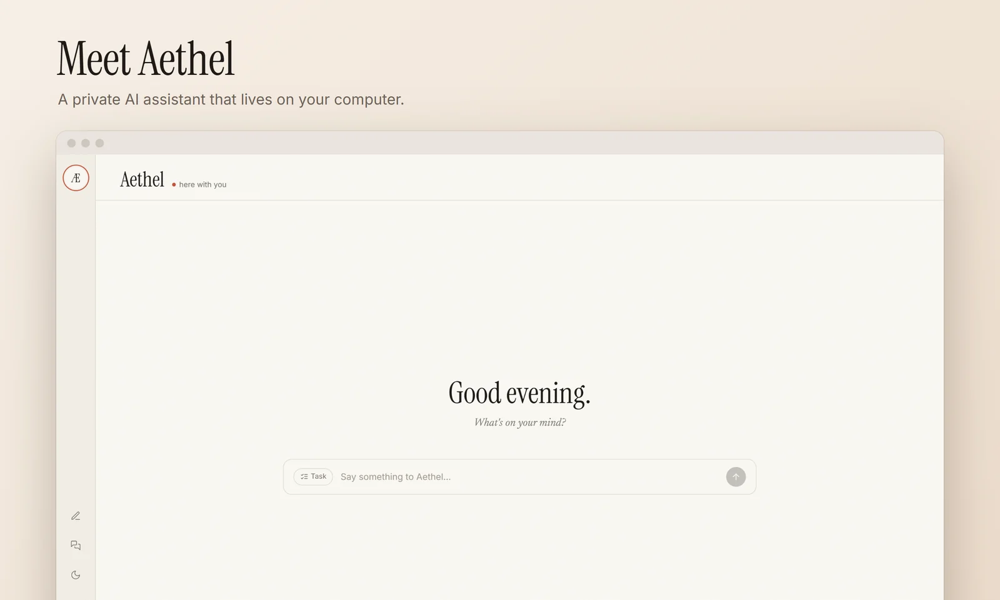</p>

Aethel talks with you, remembers what matters, and carries out tasks across your files and apps. It asks before anything risky. When it finishes a task it writes down how it did the job, in plain Markdown you can read and edit. Once a task has worked the same way three times, Aethel compiles it into a macro that replays with little or no help from the language model.

You choose where the thinking happens: your own API keys, your own server, or a model file on this PC.

> **Beta.** This is the first release of the Aethel v2 rebuild. See [Status](#status) for what isn't finished.
>
> **About the screenshots:** they show the real interface running on invented sample data, so "Maya" and her invoices aren't real. They also predate some of the beta: personas, calls and images aren't pictured yet.

## What it does

### Conversations you can come back to

Chat normally, and find any conversation again from the rail. You can use the warm built-in companion, or [a persona of your own](#also-in-the-app).

<p align="center">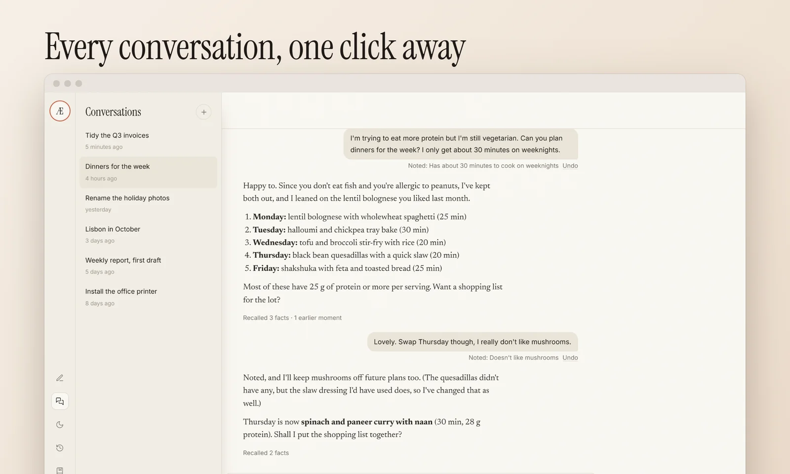</p>

### Memory you can see and change

When Aethel picks up a fact it says so under your message, with an **Undo**. When it uses one, each reply shows what it recalled, including moments from earlier conversations.

<p align="center">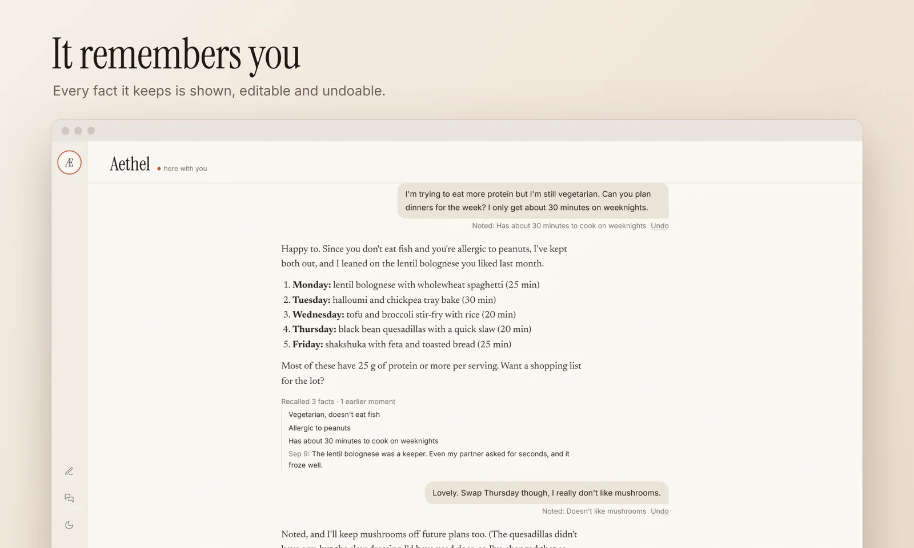</p>

The **Memory** page lists everything it knows about you, where each fact came from and how it changed. You can add, search and delete facts.

<p align="center">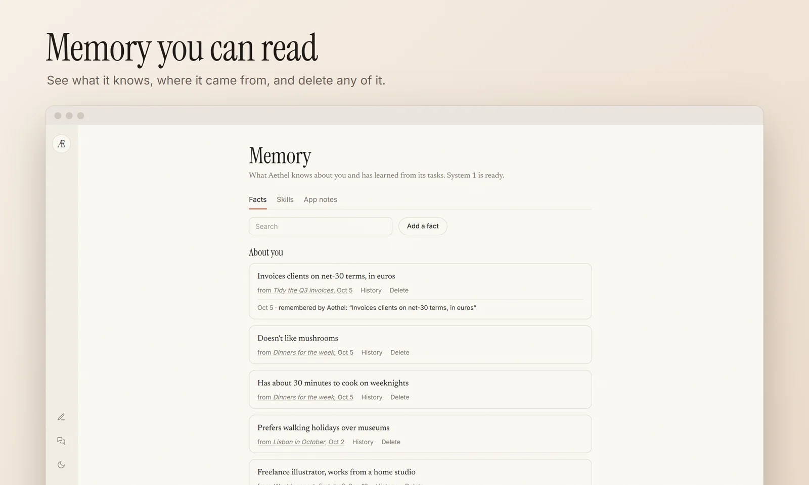</p>

### Tasks on your computer

Press **Task** and describe a goal, such as "write a haiku about rain to Documents\Aethel\haiku.txt". Aethel plans a checklist, works through it, and checks the result before reporting back.

It works with:

- files and commands;
- any Windows app, through accessibility, using [Windows-MCP](https://github.com/CursorTouch/Windows-MCP);
- Word, Excel and PowerPoint, through an in-house COM server;
- precise file edits, and reading PDFs and spreadsheets, using [Desktop Commander](https://github.com/wonderwhy-er/DesktopCommanderMCP);
- a background browser of its own.

<p align="center">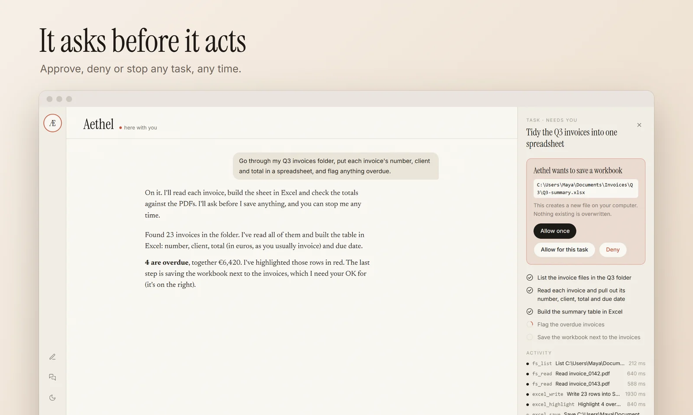</p>

Safety is built into the task system:

- **Approvals:** anything outside your allowed folders or commands waits for you. So does a click on anything that looks like it sends, buys, deletes or closes, judged by its name. Pressing Enter in a chat app isn't caught by that, so watch tasks that message people.
- **Undo:** **Undo file changes** restores the files a finished task wrote with its file and Office tools. Changes made through shell commands or by driving an app can't be undone this way.
- **Emergency stop:** **Ctrl+Alt+Esc** stops every task at once, from any app.
- **Limited tools:** only vetted tools are offered. The shell, registry and process tools in those servers are never exposed, because they would bypass your permissions.
- **Your rules:** allowed folders and commands live in `~/.aethel/permissions.yaml`.

While a task works on your screen, a soft ghost cursor shows where it's about to click.

### It learns from what it does

After each task, Aethel keeps notes on the apps it used and writes the procedure down as a **skill**, a Markdown file in `~/.aethel/knowledge/`. The next similar task starts from that skill. Skills are credited or retired by whether their tasks actually passed their checks.

Once a skill has worked **three times the same way**, it compiles into a **macro**, a list of steps stored in the skill file:

1. Each step finds its button or field again on the live screen, by name.
2. A small local model, [Laya](https://huggingface.co/convaiinnovations/laya), makes the quick judgments, such as which control is the right one when a name has changed.
3. If the screen doesn't match, the main model takes over from that point, and the macro is repaired afterwards.

Replayed steps still go through every permission check and approval.

<p align="center">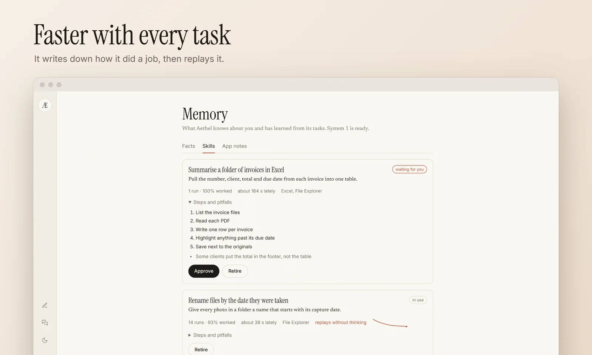</p>

Laya downloads once (about 1.7 GB) and runs on the CPU. Until it's ready, Aethel simply behaves as before.

### Replay any task

**Tasks** in the rail steps back through any past task, with a small picture of the screen after each on-screen step. **Export** saves a task as JSON and pictures.

<p align="center">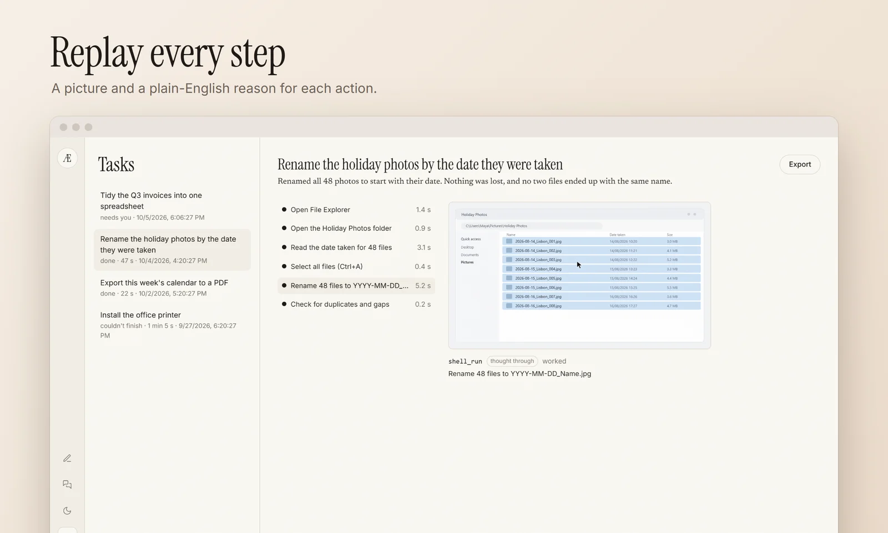</p>

### Your models, wherever they run

Give each job its own model, with fallbacks in order.

| Job | Options |
|---|---|
| Language models | Groq, Gemini, OpenRouter, or any number of your own OpenAI-compatible endpoints (LM Studio, Ollama, vLLM, another PC) |
| On this PC | Any `.gguf` with `llama-server`, from any folder, or download `llama-server` in the app |
| Images | Gemini, OpenRouter, any OpenAI-compatible images server, ComfyUI with your own workflow, or local Z-Image Turbo |
| Speech | Azure Speech, or Whisper and Kokoro voices on this PC |

<p align="center">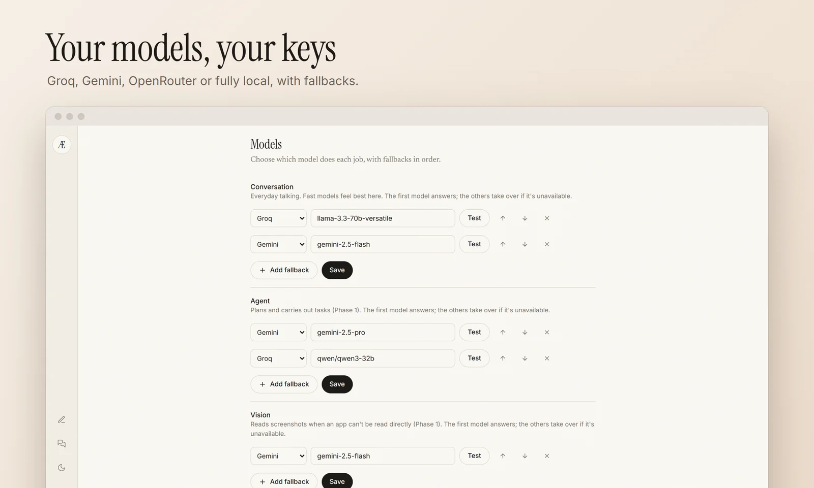</p>

**Settings** also shows token use for each kind of work, so you can see what things cost.

<p align="center">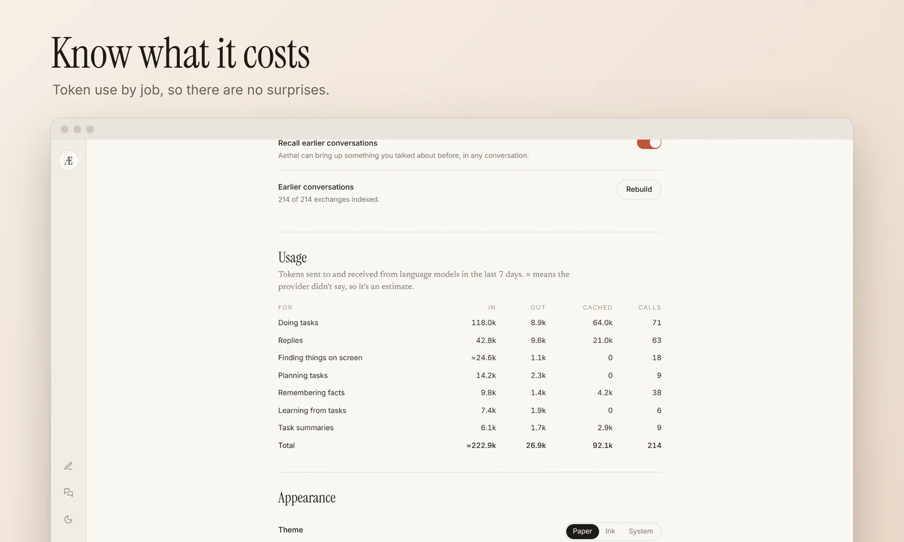</p>

### Also in the app

- **Personas:** the model drafts one from your description and you pick its face from four portraits. Each has a character sheet, a voice blend and its own accent colour, and can learn a style from a chat export.
- **Pictures:** personas can send photos that keep their face, checked by an optional local face check.
- **Calls:** hands-free voice conversations that you can interrupt.
- **Web:** search and reading with citations, switchable per conversation.

### Dark theme

<table>
  <tr>
    <td>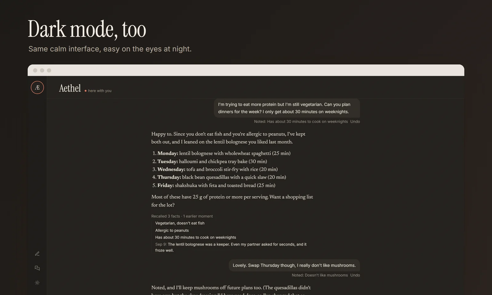</td>
    <td>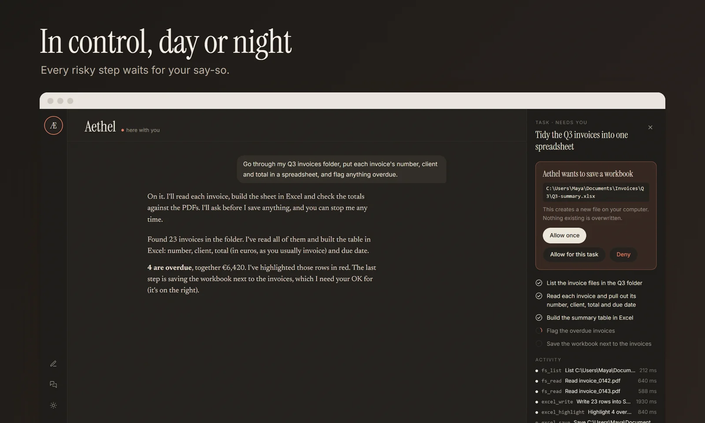</td>
  </tr>
</table>

## Install

**Windows only for now.**

1. Download `Aethel_<version>_x64-setup.exe` from [Releases](https://github.com/CodexManvik/Aethel/releases). You can check it against `SHA256SUMS.txt` with `Get-FileHash .\Aethel_*_x64-setup.exe`.
2. Run it. It installs to Program Files and asks for admin rights once. The installer isn't code-signed yet, so Windows SmartScreen may warn you: choose **More info**, then **Run anyway**.
3. Start Aethel. The first launch sets up its own Python and packages in `C:\Users\<you>\.aethel`. This happens once, takes about 3 minutes and 580 MB, and needs the internet.
4. Open **Settings → Providers** and add a key (Groq, Gemini or OpenRouter) or your own endpoint. Or use **Settings → Local model** to run everything on this PC.

[Node.js](https://nodejs.org) is needed for the background browser and Desktop Commander. Without it they say so, and everything else works.

## Your data

- **Where it lives:** settings, conversations, memory, personas and models are all in `~/.aethel`. Uninstalling leaves that folder, so delete it to remove everything.
- **API keys:** they're kept in Windows Credential Manager.
- **What leaves your PC:** with cloud models, what you send goes to the provider you chose. Azure Speech and cloud image services work the same way if you turn them on.
- **Private mode:** this runs everything on local models, so nothing leaves this computer, and web access is off.
- **Telemetry:** Aethel has no account and no telemetry of its own.

## Run from source

You'll need [Python 3.11](https://python.org), [Node.js 20+](https://nodejs.org) with [pnpm](https://pnpm.io), and [Rust](https://rustup.rs).

```powershell
py -3.11 -m venv .venv
.venv\Scripts\python -m pip install -r backend\requirements\core.txt
cd frontend_app; pnpm install; cd ..
```

**Desktop app.** The Tauri shell starts the backend itself and logs to `~/.aethel/logs/backend.log`.

```powershell
powershell -ExecutionPolicy Bypass -File scripts\start.ps1
```

**In a browser.** This runs the API on `http://127.0.0.1:8765` with auth turned off, for development only. Then run `pnpm dev` in `frontend_app` and open `http://localhost:5173`.

```powershell
powershell -ExecutionPolicy Bypass -File scripts\start.ps1 -BackendOnly
```

Set `AETHEL_MCP=0` to turn computer control off.

**Tests**

```powershell
.venv\Scripts\python -m pip install pytest pytest-asyncio
cd backend; ..\.venv\Scripts\python -m pytest; cd ..
cd frontend_app; pnpm test; cd ..
cd frontend_app\src-tauri; cargo test; cd ..\..
```

**Changing the WebSocket protocol:** edit `backend/aethel/protocol.py`, then run `py -3.11 scripts/gen_event_schema.py` and `pnpm gen:types` in `frontend_app`.

## How it's built

```
frontend_app/          Tauri 2 and React desktop app
  src/features/        conversation, tasks, memory, personas, images, call, settings
  src-tauri/           Rust shell, first-run setup, global stop key
backend/aethel/        FastAPI backend
  chat/ context/       conversations and what goes into each prompt
  runtime/             task engine, checks, reflection and macros
  tools/               files, shell, desktop, browser, Office, web
  safety/              permissions, approvals, undo
  memory/ system1/     facts, recall, and the small local judge
  personas/ images/    personas, tone, photos and the face check
  voice/ providers/    calls and speech, model routing
scripts/               start scripts and evaluation harnesses
docs/                  specs, plans and third-party licences
```

## Status

Aethel is in beta, and these parts aren't finished:

- **Evaluation:** this is still to come. Macros have only been tried on small tasks so far, and several thresholds (end of turn, face check, style recall) are marked "not measured" in Settings until they're calibrated. The harnesses are `scripts/eval_*.py`. Some call paid providers.
- **First-run onboarding:** still to come.
- **Code signing:** the installer isn't signed yet.
- **Platforms:** Windows only.

## Licence

Aethel is [MIT](LICENSE) licensed. It uses third-party software and models with their own terms: see [docs/third_party.md](docs/third_party.md).
